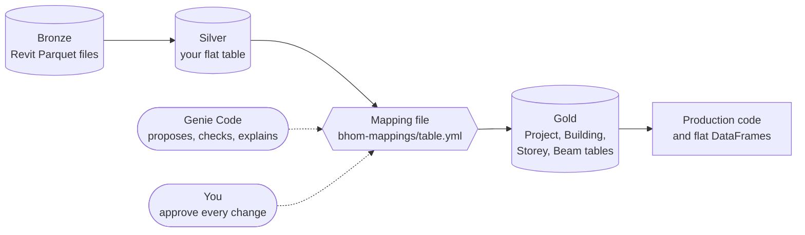

# User guide 1: from your flat tables to BHoM gold tables on Databricks

This guide is for **Python and data people who have never used `bhom-schema`**. You do not need to know BHoM or C#. By the end you will be able to:

- install the `bhom-schema` package in a Databricks notebook,
- ask **Genie Code** (the assistant next to your notebook) whether your flat table is aligned with the BHoM schema,
- have it create and keep up to date a **mapping file**, and write **gold** tables that follow the schema,
- read the gold tables back into a flat DataFrame,
- and know what to do when one of your columns has no home in the schema yet (that part is in [guide 2](User-Guide-2-Extending-The-Schema.md)).

| Guide | What it covers |
|---|---|
| **This one (1)** | The daily workflow in a Databricks notebook, with Genie Code |
| [Guide 2](User-Guide-2-Extending-The-Schema.md) | Reusing and extending the schema: adding a column or a class, the pull request, getting it approved, updating your notebook |

Contents: [1. What `bhom-schema` is](#1-what-bhom-schema-is) · [2. Install the package](#2-install-the-package-in-your-notebook) · [3. Genie Code and the skill](#3-genie-code-and-the-bhom-mapping-skill) · [4. The workflow](#4-the-workflow-in-five-steps) · [5. Everything hangs off the Project](#5-everything-hangs-off-the-project) · [6. Read gold back into a flat DataFrame](#6-read-gold-back-into-a-flat-dataframe) · [7. A column is not mapped?](#7-a-column-is-not-mapped) · [8. Keeping aligned](#8-keeping-aligned-over-time) · [9. Try it with the test notebook](#9-try-it-the-test-notebook) · [10. Troubleshooting](#10-troubleshooting)

## 1. What `bhom-schema` is

**BHoM** is Buro Happold's object model: a shared definition of the things we talk about (a project, a building, a storey, a beam) and their properties, so that tools written by different people agree on names, units and allowed values. The definitions are written in C#. **`bhom-schema` is the Python version of the same definitions**: one Python (Pydantic) class per BHoM class, generated from the C# so the two never drift apart.

For example, these classes are in the package today (the `DataSchema` assembly, for precedent building data):

| Class | What one object is | Example properties |
|---|---|---|
| `Project` | A Buro Happold project, identified by its job number | `Number`, `Name` |
| `Building` | One building (one model) of a project | `StoreysAboveGround`, `StoreysBelowGround`, material volumes |
| `Storey` | The typical storey of a building | `TypicalHeight` (metres), `NonRoofArea`, `RoofArea` |
| `Beam`, `Column`, `Slab`, `Roof`, `PileFoundation` | The structural elements of a building | `TypicalMaterial`, `TypicalSize`, `TypicalCountPerSlab` |

Every class and every property carries a description, a unit where it has one, the allowed values of an enum, and **aliases** (other names people use for it, such as "number of floors" for `StoreysAboveGround`). That metadata is what lets Genie Code decide which of your columns is which property.

### Bronze, silver, gold

You are free to work however you like while you explore data. BHoM only becomes the contract at the end:

| Layer | What it is | Who makes it | Rules |
|---|---|---|---|
| **Bronze** | The Revit data as extracted: Parquet files in a Unity Catalog volume | The extraction pipeline | Read only. Never change it |
| **Silver** | Your **flat tables**: as many columns as you like, named as you like | You, in your notebook | No BHoM rules. Each silver table gets a **mapping file** |
| **Gold** | The BHoM version of your silver table: **one table per BHoM class**, with BHoM column names, units and enum values, linked by ids | `write_gold`, when you ask | Every row is checked by the BHoM classes. Production code reads gold |



### Who does what

| `bhom-schema` package (code) | Genie Code (the assistant) | You |
|---|---|---|
| Knows the classes, properties, units and enum members. Checks every hard rule. Writes gold | Decides which BHoM class and property each of your columns means, and which enum member each text value is. Explains every error in plain words | Approve what is saved, decide what to do with a column that has no BHoM home, and say when to write gold |

Nothing is saved to the mapping file and nothing is written to gold without your approval.

## 2. Install the package in your notebook

Either run two cells yourself, or tell Genie Code to do it.

**Option A: run it yourself.** Put each of these in a cell of its own (`%pip` must be alone in its cell):

```python
%pip install --upgrade --pre --no-cache-dir --index-url https://test.pypi.org/simple/ --extra-index-url https://pypi.org/simple/ "bhom-schema[mapping]"
```

```python
dbutils.library.restartPython()
```

Then check it:

```python
import bhom_schema

print(bhom_schema.__version__, bhom_schema.__bhom_version__)
```

**Option B: ask Genie Code.** In the Genie Code panel type: *"Install the bhom-schema package in this notebook."* (The `bhom-mapping` skill also does this by itself when `import bhom_schema.mapping` fails.) It runs the same two cells.

Things worth knowing:

- `bhom-schema[mapping]` is the package plus PyYAML, which the mapping tools need (Databricks already has it).
- `--pre` installs the latest **development build** (`10.0.0a2611201430`: the version plus the date and time it was made). A merged schema change reaches it a few minutes after the merge (see [guide 2, section 9](User-Guide-2-Extending-The-Schema.md#9-the-package-is-redeployed-automatically)).
- The packages are currently on TestPyPI (hence `--index-url`). `--no-cache-dir` makes sure you get the newest build and not a cached one.
- It needs Python 3.12 or later: use serverless compute, or a cluster runtime that ships it.
- **Run the same command again to update**, then restart Python. Restarting clears your variables, so do it before the real work in the notebook.

## 3. Genie Code and the `bhom-mapping` skill

Genie Code is the assistant panel next to your notebook. The BHoM work is packaged as a **skill** called `bhom-mapping`, which a workspace admin publishes once. Check that you have it: open the Genie Code panel, start a **new chat**, and type `@bhom-mapping`. It should be listed. If it is not, ask a workspace admin to publish it. Edits to a skill apply to **new** chats only.

You use it with three commands:

| You type in the Genie Code panel | What it does |
|---|---|
| `@bhom-mapping check <catalog.schema.table>` | Is the table aligned? Answers in a few lines |
| `@bhom-mapping map <catalog.schema.table>` | Creates or updates the mapping file, step by step, asking you |
| `@bhom-mapping write gold <catalog.schema.table>` | Validates every row and writes the gold tables |

The table name is always the full three-part name. You can also ask in plain words ("is my table BHoM-aligned?"); the skill loads by itself.

## 4. The workflow in five steps

We will follow one example. Your silver table is `my_catalog.my_schema.elements_flat`, a flat table of Revit data with one row per beam family and model:

| project_number | project_name | model_name | levels_above_ground | typical_level_gap | structural_material | family_type | number_of_lifts | source_file |
|---|---|---|---|---|---|---|---|---|
| 12345 | Alpha Tower | Tower | 24 | 3900 | Steel - hot rolled | UB-0 | 6 | 12345/Tower/UB-0.parquet |
| 12345 | Alpha Tower | Tower | 24 | 3900 | glulam | UB-1 | 6 | 12345/Tower/UB-1.parquet |
| 12345 | Alpha Tower | Podium | 4 | 4200 | Steel - hot rolled | UB-0 | 2 | 12345/Podium/UB-0.parquet |

Notice what is typical of real data: the project and model repeat on every row, lengths are in millimetres, materials are free text, and some columns (`source_file`, `number_of_lifts`) may have no BHoM home.

### Step 1: build your silver table

Do this as you always do: read the Parquet files from the bronze volume (`spark.read.parquet("/Volumes/<catalog>/<schema>/<volume>/...")`), flatten, and save a table with `saveAsTable`. **Two habits help a lot:**

- Keep a `source_file` column with the Parquet path each row came from, so a gold row can be traced back to its Revit model.
- Have a **project number column**, even if it is the same on every row (`F.lit("12345")`). Section 5 explains why.

### Step 2: check alignment

In the Genie Code panel:

```text
@bhom-mapping check my_catalog.my_schema.elements_flat
```

Genie Code finds the mapping file for the table (it looks for `bhom-mappings/<table>.yml` in the notebook's folder and the folders above it) and answers in a few lines. The possible answers:

| Answer | Meaning | Next |
|---|---|---|
| `... has no mapping yet, so it is not BHoM-aligned.` | First time for this table | Step 3 |
| `The mapping ... breaks its rules:` | Someone edited the file badly; each problem is listed | Fix it with Genie (step 3) |
| `The mapping ... no longer matches ...: new columns the mapping does not know: ...` | You added or renamed columns since | Step 3 (it only needs the new columns) |
| `... is aligned: the mapping ... covers every column.` | Nothing to do | Step 5 when you want gold |

Run the check **now and then**: after you create a table, after adding columns, and before you share your tool.

### Step 3: create or update the mapping file

```text
@bhom-mapping map my_catalog.my_schema.elements_flat. Use Project as the root entity: key it on
project_number, make Building a child of Project, and make every other entity a child of Building.
```

(The last sentence matters, see [section 5](#5-everything-hangs-off-the-project).) Here is what Genie Code does, and where you come in:

1. **Asks which folder is your tool's folder** (the folder of your notebooks). The mapping goes in its `bhom-mappings` subfolder: `<your folder>/bhom-mappings/my_catalog.my_schema.elements_flat.yml`. One file per silver table, shared by every notebook that uses the table.
2. **Looks at your table** (what each column holds, a few sample rows) **and at the BHoM classes** (descriptions, aliases, units, enum members). It reads meaning, not only column names.
3. **Proposes the entities** (which BHoM classes your table holds rows of) **and their keys** (which columns identify one object). It tests each key against the data first.
4. **Maps the columns**, about twenty at a time. When the data does not settle a choice (is `typical_level_gap` in millimetres or feet?) **it asks you**.
5. **Shows you the file as a diff and waits.** You approve, edit or reject. **Nothing is saved before you approve.**
6. **Validates** the mapping against your rows, explains each problem and proposes a fix. See step 4 below.

The result is a plain YAML file you can read and edit. For the example it looks like this:

```yaml
version: 1
source: my_catalog.my_schema.elements_flat
gold_schema: my_catalog.my_gold

entities:
  Project:
    class: bhom_schema.DataSchema_oM.Project.Project
    # The columns that identify one object: rows with the same values are one Project
    key: [project_number]
    fields: {Fragments: skip, CustomData: skip}
    columns:
      Number: {from: project_number}
      Name: {from: project_name}
  Building:
    class: bhom_schema.DataSchema_oM.Building.Building
    key: [project_number, model_name]
    parent: Project
    fields: {Fragments: skip, CustomData: skip}
    columns:
      Name: {from: model_name}
      StoreysAboveGround: {from: levels_above_ground}
  Storey:
    class: bhom_schema.DataSchema_oM.Storey.Storey
    key: [project_number, model_name]
    parent: Building
    fields: {Fragments: skip, CustomData: skip}
    columns:
      TypicalHeight: {from: typical_level_gap, unit: mm}
  Beam:
    class: bhom_schema.DataSchema_oM.Elements.Beam.Beam
    key: [project_number, model_name, family_type]
    parent: Building
    fields: {Fragments: skip, CustomData: skip, MaterialDistribution: json}
    columns:
      TypicalMaterial:
        from: structural_material
        values: {Steel - hot rolled: SteelHotRolled, glulam: TimberGlulam}
      TypicalSize: {from: family_type}

unmapped:
  source_file: lineage back to the bronze Parquet file; stays in silver
  number_of_lifts: no BHoM property for the number of lifts yet
```

How to read it:

| Part | Meaning |
|---|---|
| `entities` | One entry per BHoM class your table holds rows of. The entry name (`Beam`) is also the name of its gold table |
| `class` | The Python class, from `schema_overview()`. Genie cannot invent one: it must exist in `bhom_schema` |
| `key` | The silver columns that identify one object. 24 rows of one building are **one** `Building`, because they share `project_number` and `model_name` |
| `parent` | The entity this one belongs to. The parent's key columns must be part of the child's key |
| `columns` | `<BHoM property>: {from: <silver column>}`, optionally with a `unit` (the unit **your** values are in; they are converted to the unit of the property: 3900 mm becomes 3.9 m), `values` (your text mapped to enum members) and `default` |
| `fields` | A decision for each property that has no column of its own (a list, another class). Nearly always `skip`; `json` stores it as JSON text |
| `unmapped` | Columns that deliberately have no BHoM home, each with a reason. **Every silver column must be either used or listed here**, so the file cannot silently fall behind your table |

Things to check before you approve: the **keys** make sense (a Building is a project plus a model), the **units** are right (a storey height of 3900 is not metres), the **enum text maps** are right (`glulam` is `TimberGlulam`), and the **`unmapped` reasons** are honest. A wrong mapping is worse than a missing one, so when Genie is unsure it should leave a column unmapped and ask.

The full file reference, with every key, rule and the list of known units, is in [mapping-format.md](../databricks/genie-code/skills/bhom-mapping/mapping-format.md).

### Step 4: validate

Genie Code runs the validation as part of step 3 and again before writing gold. It applies the mapping to **every row**, the same way writing gold would, and reports what does not fit. Typical problems:

| Problem | Example | Usually fixed by |
|---|---|---|
| `unknown-value` | `'Steel hot roled' is not a member of StructuralMaterial and not in values` | Adding the text to the `values` map (a typo you accept), or correcting the silver table |
| `conflict` | `levels_above_ground has more than one value for one Building` | Fixing the silver table: one building cannot have 24 and 25 levels. Or the key is too coarse |
| `unit` | `'n/a' is not a number, so the unit mm cannot be converted` | Cleaning the silver values |
| `invalid` | The BHoM class refuses the object; the message names the property | Reading the message, then fixing the data or the mapping |
| `columns` | The table has a column the mapping does not know | Mapping it, or listing it under `unmapped` |

Ask Genie *"why is this a problem and how do I fix it?"*: it explains in plain words and says whether the fix belongs in the mapping or in your silver table.

### Step 5: write gold

When the mapping is valid and you are ready:

```text
@bhom-mapping write gold my_catalog.my_schema.elements_flat
```

It validates all rows again and, only if everything fits, writes one table per entity into the `gold_schema` of the mapping:

```
my_catalog.my_gold.Project
my_catalog.my_gold.Building
my_catalog.my_gold.Storey
my_catalog.my_gold.Beam
```

What to expect:

- Each gold table has the columns, units and comments of the BHoM class (`TypicalHeight` in **metres**), and Delta constraints that only allow the members of an enum.
- Every row has a `BHoM_Guid`. It is **deterministic** (made from the entity and its key values), so running the write again does **not** add the same row twice: rows already there are left as they are (not updated, not removed; [section 8](#8-keeping-aligned-over-time) shows how to bring gold in line when silver changes).
- It **refuses to write anything** while there is a problem, and tells you why. It never drops or replaces a gold table unless you say so in the same message ("...and replace the tables").
- You need permission to create tables in the gold schema.

## 5. Everything hangs off the Project

A gold table on its own is just a list of objects. What makes them one dataset is that **every object points to its parent**, and the chain ends at the **Project**:

```
Project            Number = job number "12345", Name = "Alpha Tower"
 └─ Building       Project_id    -> the id of its Project      (Tower, Podium)
     ├─ Storey     Building_id   -> the id of its Building
     └─ Beam       Building_id   -> the id of its Building     (UB-0, UB-1)
```

- Each gold row has a `BHoM_Guid` (its id). A child row carries its parent's id in a column called `<Parent>_id`: `Project_id` in `Building`, `Building_id` in `Storey` and `Beam`.
- These ids come from the `parent` lines of the mapping file. The BHoM classes do not hold the link themselves; the gold tables do.
- Follow `Beam.Building_id` to its Building, then `Building.Project_id` to its Project, and you have the project number for every beam. That chain is what [section 6](#6-read-gold-back-into-a-flat-dataframe) uses to rebuild a **flat DataFrame**.

**The rule for your mappings:** always include a `Project` entity (key = the project number column) and make sure the `parent` chain of every other entity ends at it. Then every table you ever write can be joined up to a project, and tables from different tools line up on the same job number.

Notes:

- The tools do not enforce this: a mapping without a Project is valid. It is a convention you ask Genie to follow, which is why the prompt in step 3 spells it out. If a skill update makes it the default, the prompt still does no harm.
- No project number column in your table? Add one when you build silver: `df.withColumn("project_number", F.lit("12345"))`, and the same for a project name.
- A key must contain its parent's key columns, which is why `Beam` is keyed on `project_number, model_name, family_type`: its parent `Building` is keyed on the first two.

## 6. Read gold back into a flat DataFrame

Production code reads gold. To get back to one wide table, join the gold tables along the `_id` columns. This helper prefixes every column with its table name (so `Name` does not clash) and keeps the link columns as they are:

```python
from pyspark.sql import functions as F

from bhom_schema.tables.sql import quote_table

GOLD = "my_catalog.my_gold"

def gold_table(entity):
    """Reads a gold table with every column prefixed by the entity (Beam_TypicalSize), its BHoM_Guid as <Entity>_id, and the link to its parent unchanged (Building_id)."""
    frame = spark.table(quote_table(f"{GOLD}.{entity}")).drop("_bhomVersion", "Tags")
    columns = []
    for name in frame.columns:
        if name == "BHoM_Guid":
            columns.append(F.col(name).alias(f"{entity}_id"))
        elif name.endswith("_id"):
            columns.append(F.col(name))
        else:
            columns.append(F.col(name).alias(f"{entity}_{name}"))

    return frame.select(*columns)

# One row per beam, with its building, its project and its storey
flat = (
    gold_table("Beam")
    .join(gold_table("Building"), "Building_id", "left")
    .join(gold_table("Project"), "Project_id", "left")
    .join(gold_table("Storey"), "Building_id", "left"))

display(flat.select("Project_Number", "Project_Name", "Building_Name", "Building_StoreysAboveGround", "Storey_TypicalHeight", "Beam_TypicalSize", "Beam_TypicalMaterial"))
```

- The result has **one row per row of the table you start from** (`Beam` here). Start from `Building` and leave out the beams to get one row per building.
- Values are in the units of the BHoM properties (metres, square metres), and enums are written as member names (`SteelHotRolled`).
- Use a `left` join so a beam whose parent is missing is still visible (its parent columns are null) instead of disappearing.

If you prefer Python objects to a DataFrame, read a table back into BHoM objects (enums become Python enum members, lengths are in metres):

```python
from bhom_schema.DataSchema_oM.Elements.Beam import Beam
from bhom_schema.mapping import load_mapping
from bhom_schema.tables.spark import read_objects

mapping = load_mapping("my_catalog.my_schema.elements_flat")
beams = read_objects(spark, Beam, f"{GOLD}.Beam", fields=mapping.entity("Beam").fields)
print(beams[0].TypicalSize, beams[0].TypicalMaterial.name)
```

## 7. A column is not mapped?

Sooner or later the check, or Genie Code, tells you that a column has **no BHoM home**: here `number_of_lifts`, which is in `unmapped`. Decide which case it is:

| Case | What to do |
|---|---|
| It is **lineage or internal** (`source_file`, a QA flag, a Revit workset) and nobody else needs it | Leave it under `unmapped` with the reason. It stays in silver. Nothing else to do |
| It **has a home, but Genie was unsure** (two properties could fit, or the unit is unclear) | Answer Genie's question, or tell it which property you mean, and it updates the mapping |
| It **belongs in the schema, but no property exists** (the number of lifts of a building) | **Add it to the schema.** Go to [guide 2](User-Guide-2-Extending-The-Schema.md) |

To check whether a property already exists before you ask for a new one, search the schema in a notebook cell (or ask Genie *"is there a BHoM property for the number of lifts?"*):

```python
from bhom_schema.mapping import search_properties

for match in search_properties("lift"):
    print(match.label, "(found in", ", ".join(match.found_in) + ")")
```

No output means no property mentions lifts. Search a few synonyms too ("elevator", "floors") before concluding. If it is missing, [guide 2](User-Guide-2-Extending-The-Schema.md) takes you through adding it. It ends by sending you back here, to [step 3](#step-3-create-or-update-the-mapping-file): ask Genie to check the table again and it maps the column to the new property.

## 8. Keeping aligned over time

Silver tables change. When you add or rename columns, run `@bhom-mapping check <table>` again: it names the new columns, and `@bhom-mapping map <table>` updates the mapping for only those. After a change that matters to gold, write gold again. What it does depends on *replace*:

| You ask | What happens to the gold rows |
|---|---|
| `@bhom-mapping write gold <table>` (no *replace*, the default) | Rows whose id is **not in gold yet** are **added**. Rows already there are **neither updated nor removed**: a value you corrected in silver stays as it was in gold, a silver row you deleted stays in gold, and an existing gold table does not get a **new column** (a property you just mapped), so that write stops with a schema error |
| `@bhom-mapping write gold <table> and replace the tables` | Every gold table is **dropped and made again** from silver, so gold matches silver exactly, with all the columns of the mapping. Anything written into those gold tables by other means is lost |

So add rows with the plain command, and use *replace* after a correction, a deletion, or a new mapped property. Gold is derived from silver, so replacing is the normal way to bring it up to date. When the schema itself changes (a new property), update the package first ([guide 2, section 10](User-Guide-2-Extending-The-Schema.md#10-update-the-package-in-your-notebook)).

## 9. Try it: the test notebook

[.ci/unit-tests/notebooks/Databricks-User-Guide-Test.ipynb](../.ci/unit-tests/notebooks/Databricks-User-Guide-Test.ipynb) walks through this whole guide on a small sample table: install, silver table, check, map, write gold, flat DataFrame, and the unmapped column. **It creates tables in your catalog**, so use a schema of your own.

### Upload it to Databricks

- **Import the file.** Download the `.ipynb` file from GitHub (open it, then the *Download raw file* button). In Databricks open **Workspace**, go to your own folder (for example `/Workspace/Users/<you>/bhom-test`), then **⋮** (or *Create*) → **Import**, choose the file, and import. It appears as a notebook.

### Run it

1. **Attach compute.** Serverless, or a cluster with Python 3.12 or later. You need permission to create tables in two schemas of one catalog (they must already exist).
2. **Set the widgets** at the top: `catalog`, `schema` (silver) and `gold_schema`. Leave `use_genie` on `yes` to follow the whole guide with Genie Code, or set it to `no` to let the notebook write the mapping itself (useful to test the package alone, or when `@bhom-mapping` is not published to your workspace yet).
3. **Run the cells in order**, reading the *Expect* lines. With `use_genie = yes` the notebook stops at three **Genie Code steps** that tell you what to type in the panel; run the check cell that follows each one before going on. Each check cell says exactly what is missing if something went wrong.
4. **Clean up:** set the `cleanup` widget to `yes` and run the last cell to drop the demo tables and the mapping file.

A notebook that runs to the end with every check cell passing means the whole flow works in your workspace: the package installs, Genie Code can find the skill, a mapping can be written and validated, gold can be written and read back to a flat DataFrame.

## 10. Troubleshooting

| What you see | Why, and what to do |
|---|---|
| `@bhom-mapping` is not listed | The skill is not published to your workspace, or your chat is older than the publish. Start a new chat, refresh the page, then ask a workspace admin ([section 3](#3-genie-code-and-the-bhom-mapping-skill)) |
| `ModuleNotFoundError: bhom_schema` | The install cell did not run, or Python was not restarted afterwards ([section 2](#2-install-the-package-in-your-notebook)). Packages installed with `%pip` are lost when the compute restarts or you attach to other compute, so install again |
| `No matching distribution found` | Missing `--index-url` / `--extra-index-url`, or no network access to TestPyPI from your compute. Ask your admin |
| The new property from a schema change is missing | Your package is older than the merge. Update it ([guide 2, section 10](User-Guide-2-Extending-The-Schema.md#10-update-the-package-in-your-notebook)) |
| Check says "no mapping yet" right after Genie saved one | The file is in a folder that is not your notebook's folder or one above it. Ask Genie *"where did you save the mapping?"* and move it, or run `find_mapping("<table>")` |
| `GoldRefused: nothing was written to gold` | The mapping is not valid for the table. The message is the validation report: fix what it lists (section 4, step 4) and run it again. Nothing was written |
| Permission error on the gold schema | You cannot create tables there. Use a schema you own, or ask the owner of the catalog |
| Genie proposes a property that does not exist | It cannot: the mapping is checked against the real classes and refuses it. Ask it to list the candidates with `search_properties` |
| Gold row count is lower than expected | A silver row with an empty key column is left out of that entity (and counted in the report). Check the key columns for nulls |
