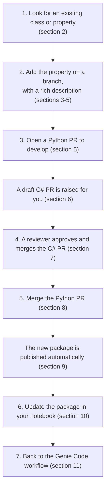

# User guide 2: reusing and extending the BHoM schema (no C# needed)

This guide is for **Python users**. You arrive here from [guide 1](User-Guide-1-From-Flat-Tables-To-Gold.md) because one of your columns has no home in the schema (in the example: `number_of_lifts`), or because you want to start new work already aligned with BHoM. You do **not** need to know C#: you write Python, and the matching C# is drafted for you.

Contents: [1. The journey](#1-the-journey-in-one-page) · [2. Find existing classes](#2-find-existing-classes-to-reuse) · [3. Read a class](#3-read-a-class) · [4. Describe it well](#4-describe-your-class-and-fields-so-genie-code-can-use-them) · [5. Make the change](#5-make-the-change-and-open-the-python-pull-request) · [6. The C# pull request](#6-check-that-the-c-pull-request-was-raised) · [7. Get the C# approved](#7-get-the-c-pull-request-approved) · [8. Merge](#8-merge-the-python-pull-request) · [9. Redeploy](#9-the-package-is-redeployed-automatically) · [10. Update your notebook](#10-update-the-package-in-your-notebook) · [11. Back to the workflow](#11-back-to-the-workflow) · [12. Troubleshooting](#12-troubleshooting)

## 1. The journey in one page

BHoM is defined in **C#**, and that C# is the **source of truth**. The Python in `src/bhom_schema` is generated from it. So a change you want in Python is a **proposal**: you write it in Python and open a **pull request (PR)**, and a matching **draft C# PR** is raised for you. The C# is merged first, the Python second.



You need **write access** to the [BHoM_PythonSchema](https://github.com/BHoM/BHoM_PythonSchema) repository (ask [Viet Le](#7-get-the-c-pull-request-approved) if you do not have it). Work on a branch of the repository itself, not on a fork: a PR from a fork gets no C# draft.

## 2. Find existing classes to reuse

**Before you add anything, check that it does not already exist.** Reusing a class is also how you start new work aligned with BHoM from day 1.

### In a notebook

After [installing the package](User-Guide-1-From-Flat-Tables-To-Gold.md#2-install-the-package-in-your-notebook):

```python
from bhom_schema.mapping import describe_class, schema_overview, search_properties

# Every class, one line each: its name, its path, what it is, how many properties
for item in schema_overview():
    print(f"{item.name:20} {item.properties:3} properties   {item.summary[:80]}")

# Everything about one class: each property with its description, unit, aliases and enum members
print(describe_class("Storey").text())

# The same, with the full descriptions (derivation, edge cases)
print(describe_class("Storey").text(full=True))

# Find a property by words: it looks in names, display texts, aliases and descriptions
for match in search_properties("storey height"):
    print(match.label, "(found in", ", ".join(match.found_in) + ")")
```

Or ask Genie Code: *"Which BHoM classes could hold the number of lifts of a building?"*

### On GitHub

Browse [src/bhom_schema](../src/bhom_schema). The folders mirror the C# model:

```
src/bhom_schema/
├── BHoM/                      base classes every object builds on (BHoMObject: Name, Tags, BHoM_Guid...)
└── DataSchema_oM/             an "assembly": the precedent-building data classes
    ├── Project.py             one class per file, the file is named after the class
    ├── Building.py
    ├── Storey.py
    ├── Elements/              a sub-folder is a namespace: Beam.py, Column.py, Slab.py...
    └── Enums/                 allowed-value lists: StructuralMaterial.py...
```

The folder name `DataSchema_oM` is the **assembly**, and it is also the first part of the Python import: `bhom_schema.DataSchema_oM.Storey`.

### Starting with BHoM from day 1

If you have not made your flat tables yet, you can skip the mapping work later by aligning from the start. From the least to the most effort:

1. **Name your silver columns after the schema.** Use `StoreysAboveGround` instead of `levels`, and store lengths in the unit of the property (metres). Mapping them is then trivial.
2. **Check any DataFrame against a class** without building objects by hand. A DataFrame whose columns are named like the properties of `Building` is checked with `validate_dataframe(df, Building, fields=BASE_SKIPPED).text()`, which lists the rows that do not fit (`from bhom_schema.mapping import validate_dataframe`, `from bhom_schema.tables import BASE_SKIPPED`).
3. **Build the objects in Python and write BHoM tables directly.** The classes validate everything you give them:

   ```python
   from bhom_schema.DataSchema_oM.Building import Building

   building = Building(Name="Tower", StoreysAboveGround=24)  # Building(StoreysAboveGround="many") is refused
   ```

   See [.ci/unit-tests/notebooks/Databricks-DataSchema-Demo.ipynb](../.ci/unit-tests/notebooks/Databricks-DataSchema-Demo.ipynb) for creating, writing and reading back tables of BHoM classes.

Whichever you choose, keep the [Project at the root](User-Guide-1-From-Flat-Tables-To-Gold.md#5-everything-hangs-off-the-project): a `Project` with the job number, and every other object linked up to it.

## 3. Read a class

Open [Storey.py](../src/bhom_schema/DataSchema_oM/Storey.py). Cut down, it is this:

```python
class Storey(BHoMObject):
    """Typical storey properties of a building: slab-to-slab height, and the floor slab areas below and at the roof."""

    TypicalHeight: Annotated[float | None, Quantity('Length', 'm'), DisplayText('Typical slab-to-slab height')] = Field(default=None, description='Median vertical distance between consecutive storey levels ... Aliases: slab-to-slab height, floor-to-floor height, storey height.')
```

| Piece | What it is |
|---|---|
| `class Storey(BHoMObject)` | A BHoM class. `BHoMObject` gives every object a `Name`, `Tags`, a `BHoM_Guid` id and room for extra data |
| The docstring | What **one object** of the class is. Genie Code reads it to decide which class a table holds rows of |
| `TypicalHeight` | A property. Names are `PascalCase`, like in C# |
| `float \| None` | The type: a number that may be missing (`None`). Use `\| None` whenever "unknown" is a real answer |
| `Quantity('Length', 'm')` | It is a physical quantity, in metres. It lets the mapping tools convert your millimetres or feet |
| `DisplayText('...')` | The human label of the property |
| `Field(default=None, description='...')` | The default value, and the description (see the next section) |

Generated classes also carry a `__bhom__` block that says where the class lives in C#. You never write it. The file header says *Do not edit by hand*: that is true for the weekly generation, which rewrites the files from the C#. A pull request is the one sanctioned way to change them, because it carries the matching C# change with it.

## 4. Describe your class and fields so Genie Code can use them

**This is the most important part of your change.** Genie Code cannot read your mind or your pipeline: it maps a silver column to a property by reading the property's metadata. A property with a one-word description will be mapped badly, or not at all. The same text becomes the C# description too, so it is also what BHoM users in other tools read.

| Metadata | Where you write it | What uses it |
|---|---|---|
| Class docstring | `"""..."""` on the class | Choosing which entity a table holds. Say what **one object** is (one per building? per project?) |
| Description | `Field(description='...')` | `describe_class` shows the **first sentence**; Genie asks for the full text when it needs it. `search_properties` searches all of it |
| `Aliases: a, b, c.` | The **last sentence** of the description | `search_properties` and Genie match your column names to these other names |
| `DisplayText('...')` | `Annotated[..., DisplayText('...')]` | The label shown next to the property, and searched |
| `Quantity('Length', 'm')` | `Annotated[..., Quantity(...)]` | The unit of the property. A column in `mm` is converted automatically. Known quantities: Length, Area, Volume, Mass, Force, Pressure, Angle, Time |
| Enum member comments | `# Steel - Hot Rolled: Classified as ...` above each member | Mapping free text such as "Steel - hot rolled" to the right member, by meaning |
| Default value | `= None`, `= 0`, `= ''` | Whether the value may be missing |

**Write each description in this order**, the way the existing properties do (read [Building.py](../src/bhom_schema/DataSchema_oM/Building.py) and [Storey.py](../src/bhom_schema/DataSchema_oM/Storey.py) for complete examples):

1. **One sentence that says what it is** and what it counts or measures. Make it stand on its own; it is what is shown first. Avoid "e.g." and abbreviations with full stops in this sentence, because the first sentence is cut at the first full stop.
2. **`Unit:`** the unit, and what a dictionary's keys or values mean, when it matters.
3. **`Derivation:`** how the value is worked out or where it comes from in the source (which Revit parameter, which rule, which rounding).
4. **`Edge cases:`** what is included and excluded, what a missing value (`None`) or `0` means, known weaknesses.
5. **`Aliases:`** other names people and tools use for it, comma separated, **as the final sentence**, with no full stops inside: `Aliases: number of elevators, lift count, lifts.`

A weak description and a good one for the same property (an **example**; it is not in the schema):

```python
# Weak: Genie cannot tell what this is, or what counts as a lift
NumberOfLifts: int = Field(0, description='lifts')

# Good
NumberOfLifts: Annotated[int | None, DisplayText('Number of lifts')] = Field(
    default=None,
    description='Number of passenger and goods lifts serving the building, each shaft counted once. '
                'Derivation: Count of lift cars in the model, grouped by shaft. '
                'Edge cases: Escalators and platform lifts are not counted. Null when the model has no lifts or the count is unknown; 0 only when it is known that there are none. '
                'Aliases: number of elevators, lift count, lifts, vertical transport.')
```

## 5. Make the change and open the Python pull request

The example in this guide is a `NumberOfLifts` property on `Building`. **It is an illustration, not a change to make.** Open [Building.py](../src/bhom_schema/DataSchema_oM/Building.py) and add one property below the existing ones, with a description as in section 4 (the imports it needs, `Annotated` and `DisplayText`, are already there):

```python
    NumberOfLifts: Annotated[int | None, DisplayText('Number of lifts')] = Field(default=None, description='Number of passenger and goods lifts serving the building, each shaft counted once. ... Aliases: number of elevators, lift count, lifts.')
```

Always give the property a **default** (`None`, `0`, `''`) and a description. Only **add** properties on your own: renaming or removing one, or changing its type, can stop old BHoM files from opening, so talk to [Viet](#7-get-the-c-pull-request-approved) first. A whole new class follows the same steps in a new file; ask Viet and see [the rules in the README](../README.md#changing-the-python-classes).

Choose where to make the edit:

### Option A: in a Git folder on Databricks

You can do all of it without leaving Databricks, if your Databricks account is linked to your GitHub account (**Settings** → **Linked accounts**, or ask your workspace admin).

1. In the workspace, click **Create** → **Git folder**, paste `https://github.com/BHoM/BHoM_PythonSchema`, and create it.
2. Open the Git folder, click the **branch name** button (it says `develop`), choose **Create branch**, and name it after your change, for example `schema/building-lifts`. **Never edit on `develop`.** The folder switches to your new branch.
3. Open `src/bhom_schema/DataSchema_oM/Building.py` and add the property. The editor saves as you type.
4. In the same Git dialog, tick the changed file, write a message (*Add NumberOfLifts to Building*), and click **Commit & Push**.
5. Open the repository on GitHub. A **Compare & pull request** banner is shown for your branch: click it, set the base branch to **`develop`**, and **Create pull request**.

The Git folder is only where you edit. Do not install the package from it: notebooks get the package as in [section 10](#10-update-the-package-in-your-notebook).

### Option B: in the browser, on GitHub

Open the file on GitHub, click the pencil (*Edit this file*), make the change, then *Commit changes...* and choose **Create a new branch for this commit and start a pull request**. Set the base to **`develop`**.

### In the PR description

Fill in **What I added and why** (which silver column or tool needs it) and leave the checklist of the template in. You tick its boxes as you go through sections 6 to 8.

## 6. Check that the C# pull request was raised

Within a few minutes a **comment appears on your PR** with a link to the **C# draft PR**, in the C# repository (`BHoM/DataSchema_Toolkit`). Open it. You do not have to understand the code. Check:

- It says `Depends on` your Python PR.
- A new property changes **only the lines of that property**; a new class gives **one new file**.
- The property name matches what you wrote, and your description text is there.

Pushing more commits to your branch **updates the same C# draft**; you never raise it yourself. No comment after ten minutes? Ask [Viet](#7-get-the-c-pull-request-approved).

## 7. Get the C# pull request approved

The C# draft is reviewed and merged in its own repository, like any BHoM change. **You ask for the review**, because nobody is told automatically. Tag the reviewer in a comment **on the C# draft** and send the link to your Python PR.

**Who to ask**

| Person | For what |
|---|---|
| **Viet Le** ([@vietle-bh](https://github.com/vietle-bh)) | First contact for everything in this guide. Code owner of this repository and owner of `DataSchema_Toolkit`: reviews the C# draft, marks it ready for review and merges it. Also write to Viet if you need write access, or a change that is not a plain new property |
| A **BHoM maintainer with write access to the C# repository** | A second reviewer for any change outside `DataSchema_Toolkit`. Viet can point you to the right person |

A reviewer **may change the C#** (a different default, a better description). That is fine: see section 8. If the C# PR is **closed without merging**, close your Python PR with a comment saying why.

## 8. Merge the Python pull request

**Never merge the Python PR before its C# PR.** Once the C# PR is **merged**:

1. On your Python PR, open **Checks** and click **Re-run all jobs**, so that it picks up the merge. Nothing does that for you.
2. If a check then shows differences, it lists them (the **first value is from the C#, the second from your PR**). Edit your Python to match what was merged and push.
3. Tick the checklist in your PR description, ask Viet to **approve**, and **merge** the PR into `develop` (or merge it yourself if you have the rights).

## 9. The package is redeployed automatically

You do not publish anything. As soon as your PR is merged into `develop`, a new **development build** of the package is made and published, a few minutes later. Its version is the BHoM version plus the date and time it was made (for example `10.0.0a2611201430`). Notebooks installed with `--pre` pick it up.

## 10. Update the package in your notebook

Run the install command again (the same two cells as in [guide 1, section 2](User-Guide-1-From-Flat-Tables-To-Gold.md#2-install-the-package-in-your-notebook)), then check that you have the change:

```python
%pip install --upgrade --pre --no-cache-dir --index-url https://test.pypi.org/simple/ --extra-index-url https://pypi.org/simple/ "bhom-schema[mapping]"
```

```python
dbutils.library.restartPython()
```

```python
import bhom_schema
from bhom_schema.mapping import search_properties

# A build made after your merge has a date and time later than the merge
print(bhom_schema.__version__)

for match in search_properties("lift"):
    print(match.label, "(found in", ", ".join(match.found_in) + ")")
```

If the property is not found yet, your build is older than the merge: wait a few minutes and try again. Packages installed with `%pip` belong to the notebook session, so every notebook that uses the new property needs the update.

## 11. Back to the workflow

Go back to [guide 1, step 3](User-Guide-1-From-Flat-Tables-To-Gold.md#step-3-create-or-update-the-mapping-file). In the Genie Code panel start a **new chat** and ask:

```text
@bhom-mapping check my_catalog.my_schema.elements_flat
```

It reports the table as out of date or not aligned. Then `@bhom-mapping map my_catalog.my_schema.elements_flat` and Genie Code finds the new property with the metadata you wrote, proposes to map `number_of_lifts` to `Building.NumberOfLifts` (and takes `number_of_lifts` out of `unmapped`), and you approve.

Finish by writing gold **and replacing the tables**, because the `Building` gold table already exists without the new column:

```text
@bhom-mapping write gold my_catalog.my_schema.elements_flat and replace the tables
```

A plain `write gold` only adds rows that are not in gold yet, and [leaves the rows that are there as they are](User-Guide-1-From-Flat-Tables-To-Gold.md#8-keeping-aligned-over-time). Replacing is safe because gold is rebuilt from silver. [Section 6 of guide 1](User-Guide-1-From-Flat-Tables-To-Gold.md#6-read-gold-back-into-a-flat-dataframe) reads the new column back into your flat DataFrame.

## 12. Troubleshooting

| What you see | Why, and what to do |
|---|---|
| A red cross on your PR, with `has no description` or a similar message | Open it and read the message: it names the file and the property. Add a docstring to the class, or `Field(description=...)` and a default to the property, then push |
| No comment with a C# link | The PR is from a fork, or changes nothing in `src/bhom_schema`. Ask Viet |
| The checks stay red after the C# merged | You did not re-run them ([section 8](#8-merge-the-python-pull-request)), or the merged C# differs from your Python. Re-run, then read the differences (first value C#, second yours) |
| The C# draft looks wrong | It is drafted from your Python. Fix the Python and push; the draft is updated. Reviewers may also edit it directly |
| The C# PR was closed unmerged | Close your Python PR with a comment, or the next weekly generation will undo your change |
| The new property is not found after the merge | Your package build is older than the merge. Wait a few minutes, then update the package again ([section 10](#10-update-the-package-in-your-notebook)) |
| Genie Code does not map the column to the new property | Its metadata is too thin. Add aliases and a clearer first sentence in a new small PR, or tell Genie which property you mean and approve the mapping |
| The Git folder cannot push | Your GitHub account is not linked in Databricks, or you have no write access to the repository. Use option B, or ask Viet |
